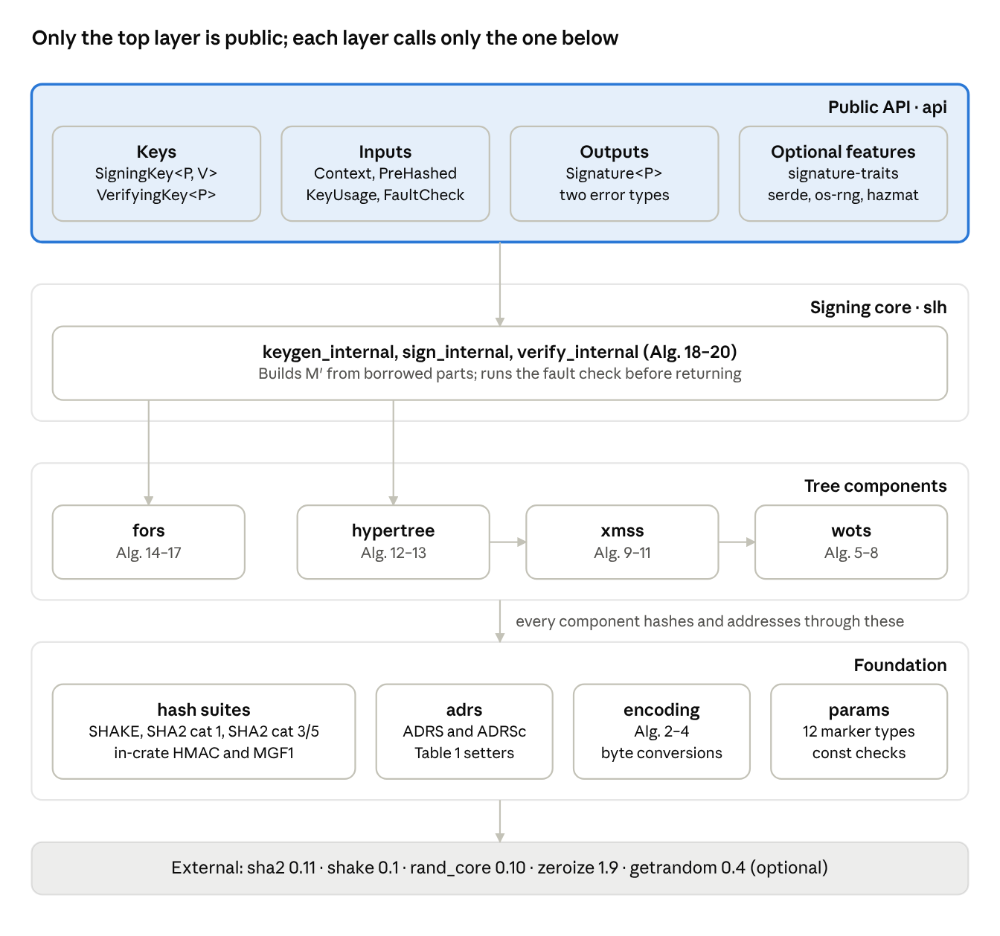
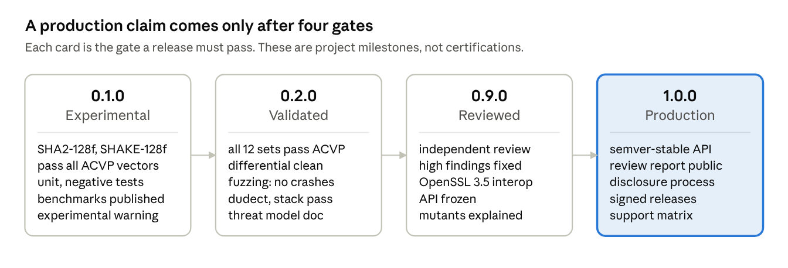

# slhsig: SLH-DSA (FIPS 205) Rust Crate — Design Document

Status: implemented and experimental (0.1.0); not independently reviewed. Last updated 2026-10-17.

## Summary

`slhsig` is a pure-Rust, `unsafe`-free implementation of SLH-DSA (FIPS 205) for server-side signing and verification. The algorithm is written fresh from the FIPS 205 pseudocode. Hashing comes from RustCrypto `sha2` and `shake`; entropy comes from `rand_core` and `getrandom`.

Version 1 covers all 12 FIPS 205 parameter sets, both pure and pre-hash (HashSLH-DSA) signing, hedged and deterministic signing, and the raw FIPS 205 byte encodings. Each parameter set ships behind a feature flag and moves to default only after it passes the validation gates in this document.

This document began as the design before any code existed; it now records the design as built, and the Implementation status section tracks what has been verified. Standards and crate facts were checked against FIPS 205 (published August 13, 2024), crates.io and docs.rs on 2026-10-16. Nothing here is a FIPS validation claim; that requires CAVP/CMVP testing, which is out of scope.

Crate name: `slhsig`, decided 2026-10-16 (`slh-dsa` and `fips205` are taken on crates.io).

## Implementation status

The implementation is in this repository, [V-k-h/slhsig](https://github.com/V-k-h/slhsig). It meets the 0.1.0 functional criteria for all 12 parameter sets; the independent review required for 0.9.0 has not started.

| Check | Result |
| --- | --- |
| NIST ACVP vectors ([ACVP-Server](https://github.com/usnistgov/ACVP-Server) commit 975de31e) | keyGen 120, sigGen 624, sigVer 504 cases; all 12 sets; internal and external interfaces, pure and pre-hash, deterministic and hedged: all pass |
| Differential vs RustCrypto `slh-dsa` 0.2.0-rc.5 and `fips205` 0.4.1 | Keys, deterministic and hedged signatures byte-identical; mutual verification; one-bit corruption rejected by all three. Local runs: 25 cases per "f" set, 4 per "s" set. Nightly CI: 1,000 per "f" set and 50 per "s" set, 6,300 cases in all: pass |
| Big-endian | ACVP suite (36 tests, all 12 sets) on `s390x-unknown-linux-gnu` under QEMU in nightly CI: pass, in about 2.6 hours |
| Harness sanity check | Swapping SHA-256 for SHA-512 in H (categories 3 and 5) fails every SHA2-192f ACVP test |
| API, unit, integration and doc tests | 60, 16, 2 and 1 tests: pass |
| Stack budget | All operations, all sets, on 64 KiB; also completes on 16 KiB (macOS arm64) |
| Lints and MSRV | `clippy -D warnings`, `rustfmt`, every feature combination warning-free; builds and passes tests on Rust 1.88 |
| dudect, key generation | Nightly, 15 minutes each for SHA2-128f, SHAKE-128f, SHA2-192f and SHAKE-256f on x86-64 Linux, arm64 Linux and macOS arm64: max \|t\| between 0.96 and 3.17 over 0.06 to 3.0 million samples; all 12 below the threshold of 5. Highest: SHA2-192f on arm64 Linux, 3.17 over 0.46 million |
| Speed, Apple M4 Pro | Signing with the default redundant check: SHA2-128f 10.4 ms, SHAKE-128f 31.5 ms (verify-only: 5.4 and 16.1 ms; no check: 5.0 and 15.5 ms). Verification: 0.29 and 0.96 ms |
| Fuzzing | Local, 15 minutes per target: parse 1,366,369 runs, verify 328,938, sign\_verify 17,741. Nightly CI, 30 minutes per target: parse 703,606, verify 87,148, sign\_verify 11,590. No crashes, no failing inputs |
| Mutation testing (`cargo-mutants` 27.1.0) | Core and API: 563 mutants, 357 caught, 206 unviable, none missed. Integrations: 24 mutants, 3 caught, 21 unviable, none missed. The first run left 29 alive: 14 are now killed by new tests (API trait impls, `set_fault_check`, `Signature::from_vec`, the serde error message, `gen_len2` boundaries); 6 disappeared when the treehash stacks were cut to their exact maximum; 9 are equivalent and listed, each with its reason, in `.cargo/mutants.toml` |
| CI (GitHub Actions) | All 9 jobs pass: lint, tests on Linux, macOS and Windows, MSRV 1.88, direct minimal versions, differential, cargo-deny and cargo-audit, fuzz build |

**Not done yet:** `cargo-vet`, property tests with `proptest`, coverage reporting, OpenSSL 3.5 interoperability tests, continuous fuzzing beyond the nightly runs, and the independent review.

**Where the implementation departs from this design:**

- **SHAKE crate.** SHAKE comes from the `shake` 0.1 crate. `sha3` 0.12 no longer contains SHAKE.
- **No `std` feature.** The crate is `no_std` with `alloc`, since `core::error::Error` covers the error types.
- **Key configuration.** `set_usage(&mut self)` and `set_fault_check` replace the `with_usage` builder; `with_fault_check` stays.
- **Added API.** `verify_bytes`, `from_slice` constructors and `as_verifying_key`.
- **Timing tests.** dudect measures key generation only. Signing work depends on the message digest, which is public, so a fixed-versus-random-key test would report that public variation as a leak.

## Goals and non-goals

The goal is an implementation reviewers can check line by line against FIPS 205, with an API that makes the unsafe choices hard to reach.

**Goals**

- **Byte-exact correctness.** Matches every NIST ACVP vector for key generation, signing and verification, including pre-hash, deterministic and internal-interface cases.
- **Misuse-resistant API.** Keys are typed per parameter set, hedged signing is the default, context strings are validated, and parsing never panics on untrusted input.
- **No secret-dependent timing.** Key generation and signing contain no branches or memory indices that depend on secret data. Secrets are zeroized on drop (best effort).
- **Bounded memory.** Signatures live on the heap. Signing fits a fixed stack budget measured in CI.
- **Traceable code.** Every function names the FIPS 205 algorithm it implements; every step carries the pseudocode line it implements.
- **Server platforms.** Linux x86\_64 and aarch64, macOS aarch64, Windows x86\_64.

**Non-goals for v1**

- `no_std`, embedded and WASM targets.
- Our own SHA-2, SHA-3 or RNG implementations.
- FIPS 140-3 module validation.
- The draft SP 800-230 parameter sets.
- SPHINCS+ round-3 or "robust" variants, which FIPS 205 does not approve.
- Multi-threaded or SIMD multi-buffer signing (a later performance phase).
- Key custody, HSM integration and stateful hash-based signatures (LMS/XMSS).
- X.509 and PKCS#8 encodings ([RFC 9909](https://www.rfc-editor.org/info/rfc9909)); planned as a later feature.

## FIPS 205 essentials

FIPS 205 approves 12 parameter sets: six shapes, each instantiated with SHA2 or SHAKE. Sizes below are from FIPS 205 Table 2. The secret key is 4n bytes (SK.seed ‖ SK.prf ‖ PK.seed ‖ PK.root); the public key is 2n bytes (PK.seed ‖ PK.root).

| Parameter sets | n | h | d | h′ | a | k | lg\_w | m | Category | pk (bytes) | sk (bytes) | sig (bytes) |
| --- | --- | --- | --- | --- | --- | --- | --- | --- | --- | --- | --- | --- |
| SHA2-128s, SHAKE-128s | 16 | 63 | 7 | 9 | 12 | 14 | 4 | 30 | 1 | 32 | 64 | 7,856 |
| SHA2-128f, SHAKE-128f | 16 | 66 | 22 | 3 | 6 | 33 | 4 | 34 | 1 | 32 | 64 | 17,088 |
| SHA2-192s, SHAKE-192s | 24 | 63 | 7 | 9 | 14 | 17 | 4 | 39 | 3 | 48 | 96 | 16,224 |
| SHA2-192f, SHAKE-192f | 24 | 66 | 22 | 3 | 8 | 33 | 4 | 42 | 3 | 48 | 96 | 35,664 |
| SHA2-256s, SHAKE-256s | 32 | 64 | 8 | 8 | 14 | 22 | 4 | 47 | 5 | 64 | 128 | 29,792 |
| SHA2-256f, SHAKE-256f | 32 | 68 | 17 | 4 | 9 | 35 | 4 | 49 | 5 | 64 | 128 | 49,856 |

Rules from the standard that shape the design:

- **Two signing variants.** Hedged signing mixes in n fresh random bytes (`addrnd`); deterministic signing substitutes PK.seed. Hedged "is the default and should be used on platforms where side-channel attacks are a concern" (§9.2). Keys "should only be used" for one variant (§10.1).
- **Context string.** At most 255 bytes, empty by default. Signing returns an error and verification returns false when it is longer (Algorithms 22–25).
- **Pure message encoding.** M′ = 0x00 ‖ len(ctx) ‖ ctx ‖ M (Algorithm 22).
- **Pre-hash encoding.** M′ = 0x01 ‖ len(ctx) ‖ ctx ‖ DER(OID of PH) ‖ PH(M) (Algorithm 23). FIPS 205 lists SHA-256, SHA-512, SHAKE128 (256-bit output) and SHAKE256 (512-bit output). SHA-256 and SHAKE128 suit category 1 sets only.
- **Pure is preferred.** Pre-hash exists for modules that cannot hold large messages. Each key pair is recommended for one mode only.
- **Key generation entropy.** SK.seed, SK.prf and PK.seed come from an approved RBG with at least 8n bits of security strength.
- **Usage limit.** Each key pair may sign up to 2^64 messages.
- **Message binding.** Except for the two 128f sets, a key owner can find H\_msg collisions below the claimed category. Protocols that need message-bound signatures must account for this or apply a BUFF-style transform (§11).

NIST's [SP 800-230 initial public draft](https://csrc.nist.gov/pubs/sp/800/230/ipd) (April 13, 2026) adds six parameter sets limited to 2^24 signatures per key. It is not final and is out of scope for v1. The parameter-set design must still admit new sets without API changes.

## Key decisions

We write the SLH-DSA construction ourselves from the FIPS 205 pseudocode, reuse RustCrypto's hash crates, and test against two independent implementations.

| Decision | Choice | Why |
| --- | --- | --- |
| Core algorithms | Fresh code from FIPS 205; no porting | Keeps two independent differential oracles. The core is about 2,000 lines, and porting would still mean rewriting the API, hash layer and dependency versions. |
| Hash primitives | RustCrypto `sha2` 0.11 and `shake` 0.1 | Mature, widely deployed; writing our own SHA-2/SHA-3 adds risk without benefit. |
| HMAC and MGF1 | Implemented in-crate over `sha2` | Each is under 30 lines; ACVP vectors exercise both through PRF\_msg and H\_msg. |
| Entropy | Caller supplies a `rand_core` 0.10 `TryCryptoRng`; an `os-rng` feature wraps `getrandom::SysRng` | Entropy failures surface as `Result`, and callers can plug in an HSM-backed or DRBG source. |
| Signing variant | Hedged by default; deterministic is a separate key type | FIPS 205 §9.2 default; §10.1 says keys serve one variant. |
| Differential oracles | RustCrypto `slh-dsa` and integritychain `fips205` (dev-dependencies only) | Two implementations we did not write and did not read before writing ours. |
| Test vectors | NIST ACVP-Server `SLH-DSA-{keyGen,sigGen,sigVer}-FIPS205` | The only official FIPS 205 vectors. SPHINCS+ round-3 KATs are incompatible (FIPS 205 Appendix A). |
| Memory model | `no_std` with `alloc`; signatures heap-allocated | Portable at no cost (`core::error::Error` covers the errors); avoids the stack pressure RustCrypto's docs warn about. |
| Unsafe code | `#![forbid(unsafe_code)]` | Nothing in the design needs it. |

**Clean-room rule.** Engineers read the oracle crates' source only after their own component passes ACVP vectors. We may reuse the oracles' test harnesses (ACVP loader, dudect setup, fuzz targets) with attribution, since both are licensed MIT OR Apache-2.0.

## Threat model and security properties

The crate protects the secret key and the correctness of signatures; key custody and host security belong to the integrator.

**Assets:** SK.seed and SK.prf; the guarantee that only valid FIPS 205 signatures verify; the availability of the signing service.

| Adversary | Capability | Design response |
| --- | --- | --- |
| Chosen-message requester | Submits messages and contexts to be signed | EUF-CMA security of SLH-DSA; strict context validation; service-level rate limits (Server integration) |
| Untrusted verifier input | Supplies arbitrary public keys, signatures and messages | Exact-length parsing, no panics, fixed verification cost per parameter set; fuzzed |
| Co-resident timing observer | Measures timing or cache behavior on shared hardware | No secret-dependent branches or indices in key generation and signing; hedged signing by default |
| Fault injector | Induces computation faults (hardware errors, Rowhammer) | Redundant signing by default; verify-only and none are opt-outs (Side channels and faults) |
| Memory reader | Reads freed memory, core dumps or swap | Zeroize-on-drop for secrets; no `Debug` or `Display` of secret bytes |
| Supply-chain attacker | Compromises a dependency release | Vetted version floors, `cargo-deny`, `cargo-audit`, `cargo-vet`; minimal dependency set |
| Integrator mistakes | Mixes variants, drops contexts, signs digests in pure mode | Typed keys, separate pre-hash API, key-usage locks (Public API) |

**Properties we claim (each backed by evidence in Validation):**

- Output is byte-identical to FIPS 205 for every supported parameter set, variant and interface.
- Verification accepts exactly the signatures FIPS 205 accepts.
- Parsing and verification never panic and never allocate in proportion to attacker input beyond the message itself.
- Key generation and signing have no secret-dependent control flow or memory access. Every index the signer derives (tree, leaf, FORS indices, WOTS+ chain lengths) is public, because the verifier recomputes it from the signature.
- Owned secret buffers are zeroized on drop.

**Properties we do not claim:** message-bound signatures (see FIPS 205 §11), protection against a compromised host or OS, constant-time verification (its inputs are public), and FIPS 140-3 validation.

## Architecture

One published crate, with a private core arranged in layers. Only the API layer is public, and each layer calls only the layer below it.



Arrows are calls. The testkit, fuzz targets, benchmarks and timing harness sit outside the published crate and use only the public API plus `hazmat`. We split out a second published crate only if a real boundary appears, such as the later SIMD backend.

```text
<crate>/
├── Cargo.toml
├── src/
│   ├── lib.rs            # forbid(unsafe_code), re-exports, feature gates
│   ├── api/
│   │   ├── keys.rs       # SigningKey, VerifyingKey: generation, import, export
│   │   ├── sign.rs       # Algorithms 22-23 and the fault check
│   │   ├── verify.rs     # Algorithms 24-25
│   │   ├── context.rs    # Context, PreHash, PreHashed, KeyUsage
│   │   ├── signature.rs  # Signature<P>
│   │   ├── error.rs
│   │   └── traits.rs     # signature-traits feature
│   ├── slh.rs            # Algorithms 18-20
│   ├── hypertree.rs      # Algorithms 12-13
│   ├── xmss.rs           # Algorithms 9-11
│   ├── wots.rs           # Algorithms 5-8
│   ├── fors.rs           # Algorithms 14-17
│   ├── adrs.rs
│   ├── encoding.rs       # Algorithms 2-4
│   ├── params.rs         # ParameterSet, 12 markers, Algorithm 1, const checks
│   ├── hash/
│   │   ├── mod.rs        # HashSuite trait, MsgParts
│   │   ├── shake.rs
│   │   ├── sha2.rs       # category 1 and categories 3/5
│   │   ├── hmac.rs
│   │   └── mgf1.rs
│   └── hazmat.rs         # hazmat feature
├── tests/                # ACVP, negative, property and stack tests
│   └── acvp/             # vendored, gzipped vectors
├── testkit/              # unpublished: differential tests against the oracles
├── fuzz/                 # cargo-fuzz targets
├── benches/              # criterion
└── dudect/               # timing harness
```

## Parameter sets in the type system

Each parameter set is a zero-sized marker type implementing one sealed `ParameterSet` trait, and the whole core is generic over that trait. Only n needs to size arrays, and it does so through an associated array type, so this works on stable Rust without `generic_const_exprs`.

```rust
mod sealed { pub trait Sealed {} }

pub trait ParameterSet: sealed::Sealed + 'static {
    /// Hash suite: fixes n through its Node type ([u8; 16], [u8; 24] or [u8; 32]).
    type Hash: HashSuite;
    const NAME: &'static str;         // "SLH-DSA-SHAKE-128f"
    const CATEGORY: u8;               // 1, 3 or 5
    const H: u32;  const D: u32;  const HP: u32;   // h, d, h'
    const A: u32;  const K: u32;  const LG_W: u32; // a, k, lg_w
    const M: usize;                                // H_msg output bytes
    const PK_BYTES: usize;  const SK_BYTES: usize;  const SIG_BYTES: usize;
    /// Encoded key forms, e.g. [u8; 32] and [u8; 64] for n = 16.
    type PkBytes: Copy + AsRef<[u8]> + for<'a> TryFrom<&'a [u8]>;
    type SkBytes: AsRef<[u8]> + Zeroize + for<'a> TryFrom<&'a [u8]>;
}

#[cfg(feature = "shake-128f")]
pub enum Shake128f {}   // uninhabited marker; one per set, generated by one macro
```

Why this shape:

- **Arrays come only from n.** WOTS+ public keys, FORS roots and authentication paths are never collected into arrays. T\_len and T\_k hash their inputs as a stream, and signature components are written straight into the heap signature buffer. Only `Node = [u8; n]` must be a fixed-size array.
- **Other parameters stay constants.** h, d, h′, a, k, len and m are associated constants. Monomorphization turns them into literals, so loops compile as if hand-specialized.
- **One macro, kept small.** It declares the 12 marker types and their trait impls. The algorithm code contains no macros.
- **Sealed trait.** Downstream crates cannot add unvalidated parameter sets. SP 800-230 sets, if approved, are new marker types plus a usage-limit hook, with no change to the public API.
- **Constants checked at compile time.** A `const` assertion per set recomputes PK\_BYTES, SK\_BYTES, SIG\_BYTES, m and len from n, h, d, a, k and lg\_w, so a typo in Table 2 values fails the build.

Rejected alternatives: const generics threaded through every function (long parameter lists, plus a macro bridge from P to the constants); `hybrid-array` with typenum (an extra dependency and opaque compiler errors); maximum-size buffers sliced at runtime (moves length errors from compile time to run time).

## Hash suites and addressing

Three hash suites implement one internal `HashSuite` trait, and the hash choice is made per function, never per parameter set. That is where the SHA2 category 3/5 trap lives.

```rust
pub(crate) trait HashSuite {
    type Node: Copy + Default + AsRef<[u8]> + AsMut<[u8]> + Zeroize; // [u8; n]
    type Seeded: Clone;  // hasher state with PK.seed already absorbed

    fn seed(pk_seed: &Self::Node) -> Self::Seeded;
    fn prf(s: &Self::Seeded, adrs: &Adrs, sk_seed: &Self::Node) -> Self::Node;
    fn f(s: &Self::Seeded, adrs: &Adrs, m1: &Self::Node) -> Self::Node;
    fn h(s: &Self::Seeded, adrs: &Adrs, l: &Self::Node, r: &Self::Node) -> Self::Node;
    fn t_begin(s: &Self::Seeded, adrs: &Adrs) -> impl TStream<Self::Node>; // T_l streamed
    fn prf_msg(sk_prf: &Self::Node, opt_rand: &Self::Node, m: &MsgParts) -> Self::Node;
    fn h_msg(r: &Self::Node, pk_seed: &Self::Node, pk_root: &Self::Node, m: &MsgParts, out: &mut [u8]);
}
```

`MsgParts` carries M′ as borrowed pieces (domain byte, context length, context, optional OID and digest, message). The message is never copied to build M′.

| Function | SHAKE (§11.1) | SHA2 category 1 (§11.2.1) | SHA2 categories 3 and 5 (§11.2.2) |
| --- | --- | --- | --- |
| PRF | SHAKE256, full ADRS | SHA-256, ADRSc, 64−n pad | SHA-256, ADRSc, 64−n pad |
| F | SHAKE256, full ADRS | SHA-256, ADRSc, 64−n pad | SHA-256, ADRSc, 64−n pad |
| H | SHAKE256, full ADRS | SHA-256, ADRSc, 64−n pad | **SHA-512**, ADRSc, **128−n pad** |
| T\_l | SHAKE256, full ADRS | SHA-256, ADRSc, 64−n pad | **SHA-512**, ADRSc, **128−n pad** |
| PRF\_msg | SHAKE256 | HMAC-SHA-256, truncated to n | **HMAC-SHA-512**, truncated to n |
| H\_msg | SHAKE256 to m bytes | MGF1-SHA-256(R ‖ PK.seed ‖ SHA-256(R ‖ PK.seed ‖ PK.root ‖ M), m) | **MGF1-SHA-512**(R ‖ PK.seed ‖ SHA-512(…), m) |

Design rules for the hash layer:

- **The pad belongs to the hash.** SHA-256 calls pad PK.seed to 64 bytes; SHA-512 calls pad it to 128. The suite type picks both together, so they cannot be mixed up.
- **Seeded state.** PK.seed plus its pad fills exactly one compression block. `Seeded` caches the state after that block, which halves the compression calls for SHA-256 F at n = 16 (two blocks become one). The SHAKE suite caches its absorbed PK.seed too.
- **HMAC and MGF1 in-crate.** Both are written against `sha2` and tested directly: HMAC against the RFC 4231 vectors, MGF1 against a short Python reference in the test kit, both in addition to ACVP.

**Addresses.** `Adrs` stores the full 32-byte ADRS of FIPS 205 Figure 2: layer (4 bytes), tree (12 bytes), type (4 bytes), then 12 type-specific bytes. All words are big-endian.

- Setters mirror FIPS 205 Table 1 by name: `set_layer`, `set_tree`, `set_type_and_clear`, `set_key_pair`, `set_chain`, `set_hash`, `set_tree_height`, `set_tree_index`.
- `set_type_and_clear` is the only way to change the type, and it zeroes the final 12 bytes, as the pseudocode assumes.
- The type is a Rust enum: `WotsHash = 0`, `WotsPk = 1`, `Tree = 2`, `ForsTree = 3`, `ForsRoots = 4`, `WotsPrf = 5`, `ForsPrf = 6`.
- SHA2 suites compute ADRSc = ADRS\[3\] ‖ ADRS\[8..16\] ‖ ADRS\[19\] ‖ ADRS\[20..32\] (22 bytes) at hash time, so there is one address type for every suite.
- The tree address takes a `u64` written to bytes 8..16, with bytes 4..8 always zero.

**64-bit index trap.** Algorithm 19 reduces idx\_tree mod 2^(h − h/d). For SHA2-256f and SHAKE-256f that exponent is 68 − 4 = 64, so a naive `1u64 << 64` panics in debug builds. In release the shift amount is masked to 0, so idx\_tree silently becomes 0 for every signature. Signing and verification still agree, but every signature reuses one bottom-layer tree, which ruins FORS few-time security. ACVP vectors catch this. Index extraction uses a helper that masks with `u64::MAX` when the bit count is 64, with a dedicated unit test per parameter set.

## FIPS 205 algorithm map

Every FIPS 205 algorithm becomes exactly one function. Each function's doc comment names its algorithm number, and each step carries the pseudocode line it implements.

| Alg. | FIPS 205 name | Module · function | Implementation notes |
| --- | --- | --- | --- |
| 1 | gen\_len2 | `params` · const fn `gen_len2` | Evaluated at compile time; asserted equal to 3 for lg\_w = 4 |
| 2 | toInt | `encoding` · `to_int` | Big-endian; at most 8 bytes, returns `u64` |
| 3 | toByte | `encoding` · `to_byte` | Writes into a caller slice; no allocation |
| 4 | base\_2b | `encoding` · `base_2b` | Fills a fixed-capacity buffer; lengths checked by `debug_assert` |
| 5 | chain | `wots` · `chain` | Loop bounds public; uses seeded hasher |
| 6 | wots\_pkGen | `wots` · `pk_gen` | Chain ends streamed into T\_len, no array of len nodes |
| 7 | wots\_sign | `wots` · `sign` | Writes len × n bytes into the signature slice |
| 8 | wots\_pkFromSig | `wots` · `pk_from_sig` | Reads from the signature slice |
| 9 | xmss\_node | `xmss` · `node` | Iterative treehash with an explicit stack of h′ + 1 nodes |
| 10 | xmss\_sign | `xmss` · `sign` | Writes WOTS+ signature, then auth path |
| 11 | xmss\_pkFromSig | `xmss` · `pk_from_sig` | Leaf parity decides left or right; index is public |
| 12 | ht\_sign | `hypertree` · `sign` | d layers written in order |
| 13 | ht\_verify | `hypertree` · `verify` | Final root comparison is not constant-time (public data) |
| 14 | fors\_skGen | `fors` · `sk_gen` | PRF with FORS\_PRF address |
| 15 | fors\_node | `fors` · `node` | Iterative treehash, explicit stack of a + 1 nodes |
| 16 | fors\_sign | `fors` · `sign` | k × (1 + a) nodes into the signature slice |
| 17 | fors\_pkFromSig | `fors` · `pk_from_sig` | Roots streamed into T\_k |
| 18 | slh\_keygen\_internal | `slh` · `keygen_internal` | Crate-private; exposed as `from_seeds` only under the `hazmat` feature |
| 19 | slh\_sign\_internal | `slh` · `sign_internal` | Index extraction through the 64-bit-safe helper |
| 20 | slh\_verify\_internal | `slh` · `verify_internal` | Length checked first: (1 + k(1 + a) + h + d·len)·n |
| 21 | slh\_keygen | `api::keys` · `SigningKey::try_generate` | Three n-byte draws from the caller's RNG |
| 22 | slh\_sign | `api::sign` · `try_sign` (hedged), `sign` (deterministic) | Builds `MsgParts` with domain byte 0 |
| 23 | hash\_slh\_sign | `api::sign` · `try_sign_prehashed` (hedged), `sign_prehashed` (deterministic) | Domain byte 1, DER OID, digest |
| 24 | slh\_verify | `api::verify` · `verify` | Over-long contexts cannot reach here (Context::new rejects them); a failed check returns `Err` |
| 25 | hash\_slh\_verify | `api::verify` · `verify_prehashed` | Digest length checked against the named hash |

The FIPS 205 recursions (Algorithms 9 and 15) become iterative treehash loops. The pseudocode recursion is short, but h′ = 9 and a = 14 make its call depth and node copies avoidable stack cost. ACVP vectors prove the two forms equal.

## Public API

The signing variant is part of the key's type, so the FIPS 205 rule that a key serves one variant is enforced by the compiler. Context strings and pre-hash digests are validated when they are constructed, so the sign and verify paths never see invalid ones.

```rust
pub struct Hedged;          // default variant
pub struct Deterministic;

pub struct SigningKey<P: ParameterSet, V: Variant = Hedged> { /* zeroize-on-drop, private */ }
pub struct VerifyingKey<P: ParameterSet> { /* PK.seed, PK.root, cached seeded hasher */ }
pub struct Signature<P: ParameterSet> { /* Box<[u8]> of exactly P::SIG_BYTES */ }

pub struct Context<'a>(&'a [u8]);           // ≤ 255 bytes, checked in Context::new
pub enum PreHash { Sha256, Sha512, Shake128, Shake256 }
pub struct PreHashed<'a> { /* PreHash + digest of the exact length */ }
pub enum KeyUsage { Pure, PreHash(PreHash) }  // FIPS 205: one mode per key pair

impl<P: ParameterSet, V: Variant> SigningKey<P, V> {
    pub fn try_generate<R: TryCryptoRng + ?Sized>(rng: &mut R) -> Result<Self, Error>;
    #[cfg(feature = "os-rng")]
    pub fn generate() -> Result<Self, Error>;                  // getrandom::SysRng
    pub fn from_bytes(sk: &P::SkBytes) -> Result<Self, Error>;  // see Encoding
    pub fn to_bytes(&self) -> Zeroizing<P::SkBytes>;
    pub fn verifying_key(&self) -> VerifyingKey<P>;
    pub fn set_usage(&mut self, usage: KeyUsage) -> Result<(), Error>; // default Pure
    pub fn with_fault_check(self, mode: FaultCheck) -> Self;          // default Redundant
}

impl<P: ParameterSet> SigningKey<P, Hedged> {
    pub fn try_sign<R: TryCryptoRng + ?Sized>(&self, rng: &mut R, msg: &[u8], ctx: Context<'_>)
        -> Result<Signature<P>, Error>;
    pub fn try_sign_prehashed<R: TryCryptoRng + ?Sized>(&self, rng: &mut R, d: PreHashed<'_>, ctx: Context<'_>)
        -> Result<Signature<P>, Error>;
}

impl<P: ParameterSet> SigningKey<P, Deterministic> {
    pub fn sign(&self, msg: &[u8], ctx: Context<'_>) -> Result<Signature<P>, Error>;
    pub fn sign_prehashed(&self, d: PreHashed<'_>, ctx: Context<'_>) -> Result<Signature<P>, Error>;
}

impl<P: ParameterSet> VerifyingKey<P> {
    pub fn from_bytes(pk: &P::PkBytes) -> Self;
    pub fn verify(&self, msg: &[u8], ctx: Context<'_>, sig: &Signature<P>) -> Result<(), VerificationError>;
    pub fn verify_prehashed(&self, d: PreHashed<'_>, ctx: Context<'_>, sig: &Signature<P>)
        -> Result<(), VerificationError>;
}

#[non_exhaustive]
pub enum Error {
    ContextTooLong, InvalidKeyLength, InvalidSignatureLength, InvalidDigestLength,
    PreHashTooWeak,      // SHA-256 or SHAKE128 with a category 3 or 5 set
    UsageMismatch,       // pure call on a pre-hash key, or the reverse
    InconsistentKey,     // PK.root does not match SK.seed (checked import)
    Entropy,             // the RNG failed: FIPS 205 Alg. 22 line 6
    SelfCheckFailed,     // the fault check (Side channels and faults) failed; no signature is returned
}
pub struct VerificationError;  // opaque: no reason is reported
```

API rules:

- **No implicit RNG on the hedged path.** `try_sign` takes the RNG explicitly. With `os-rng` enabled, a `sign` convenience uses `SysRng`.
- **Explicit context.** Every sign and verify call takes a `Context`; `Context::EMPTY` is the default value, so dropping the context is visible in code review.
- **Pre-hash is its own type.** `PreHashed::new(PreHash::Sha512, digest)` checks the digest length (32 or 64 bytes). `PreHash::Sha512.digest(msg)` computes it in-crate. A raw `&[u8]` is never accepted as a digest.
- **Category check.** Pre-hash with SHA-256 or SHAKE128 on a category 3 or 5 set returns `PreHashTooWeak`, following FIPS 205 §10.2.2.
- **Trait derivations.** `SigningKey` derives no `Clone`, `Copy`, `PartialEq` or `Serialize`, and its `Debug` prints only the parameter-set name. `VerifyingKey` and `Signature` derive `Clone`, `Eq` and `Hash`, and their `Debug` prints hex. All types are `Send` and `Sync`.
- **Ecosystem traits** (feature `signature-traits`, `signature` 3.0): `RandomizedSigner` for hedged keys, `Signer` for deterministic keys, `Verifier`, `Keypair`, `SignatureEncoding`. The traits carry no context, so these impls are pure signing with the empty context. `DigestSigner` is not mapped to HashSLH-DSA.

## Encoding and secret handling

The crate speaks only the raw FIPS 205 byte encodings in v1. Every parse checks the exact length, and secret material lives only in zeroize-on-drop containers.

| Object | Encoding | Length | Import check |
| --- | --- | --- | --- |
| Public key | PK.seed ‖ PK.root | 2n bytes | Exact length; no other validation is possible |
| Secret key | SK.seed ‖ SK.prf ‖ PK.seed ‖ PK.root | 4n bytes | Exact length; `from_bytes` recomputes PK.root and returns `InconsistentKey` on mismatch |
| Signature | R ‖ SIG\_FORS ‖ SIG\_HT | (1 + k(1 + a) + h + d·len)·n bytes | Exact length, as Algorithm 20 line 1 requires |

**Checked secret-key import.** Recomputing PK.root costs one top-layer XMSS tree, the same as key generation. It catches truncated, corrupted or mis-paired keys before they sign anything. A `from_bytes_unchecked` constructor skips it for key stores that already authenticate their blobs; verify-after-sign still catches a bad key at first use.

**Secret handling:**

- SK.seed and SK.prf sit in a private `SecretKey<P>` that implements `ZeroizeOnDrop`. `to_bytes` returns `Zeroizing<P::SkBytes>`.
- Secret intermediates are zeroized before the function returns: `opt_rand`, `addrnd`, PRF outputs, WOTS+ chain starts and FORS leaf secrets.
- The crate never logs, formats or serializes a secret. `serde` support covers `VerifyingKey` and `Signature` only.
- Zeroization is best effort. It cannot erase copies the compiler made in registers or spilled stack slots, or pages the OS swapped out. The crate docs say so, and recommend `mlock` or a dedicated signer process where that matters.

**Later (feature `pkcs8`):** SubjectPublicKeyInfo and PKCS#8 encodings with the OIDs from [RFC 9909](https://www.rfc-editor.org/info/rfc9909), tested against independent encoders. The raw encodings remain the canonical internal form.

## Side channels and faults

Timing is handled by construction: secrets only ever enter hash inputs. Faults need redundant computation, because the best-known fault attack yields signatures that still verify.

**Timing and cache behavior**

- **Where secrets flow.** SK.seed enters only PRF (WOTS+ and FORS secret values); SK.prf enters only PRF\_msg. Everything that steers control flow is public: tree and leaf indices, FORS indices and WOTS+ chain lengths all come from H\_msg, which the verifier recomputes.
- **Rules for reviewers.** No branch, loop bound or array index may depend on SK.seed, SK.prf, `opt_rand`, or any PRF output before it is hashed into a public node. No secret comparisons are needed anywhere, so `subtle` is not a dependency.
- **Hash backends.** SHA-2 and Keccak have no data-dependent branches or table lookups. We rely on the `sha2` and `sha3` crates (including their hardware-accelerated backends) not to add any, and we re-measure them in our own timing tests.
- **Hedged by default.** Fresh `addrnd` per signature means repeated signing of one message never repeats the computation, which blunts differential power and EM analysis. This is FIPS 205's reason for preferring the hedged variant.
- **Evidence.** A `dudect-bencher` harness compares fixed versus random secret keys for key generation on each CI platform. Signing is not measured this way: its work depends on the message digest, which is public, so the test would report that variation as a leak. A reviewer checklist covers the rules above.

**Faults**

Castelnovi, Martinelli and Prest's ["Grafting Trees"](https://eprint.iacr.org/2018/102) (PQCrypto 2018) forges signatures on any message from a single faulted signature, and "the faulted signatures remain valid". [Genêt et al.](https://eprint.iacr.org/2018/674) demonstrated it in practice and note that stateless schemes are harder to protect than XMSS or LMS. A server that never releases a faulted signature is protected; verify-after-sign alone cannot detect one.

| Mode | What it does | Catches | Cost |
| --- | --- | --- | --- |
| `FaultCheck::Verify` | Verifies the signature before returning it | Faults that break validity: R, FORS, final layer, memory corruption of the output | One verification |
| `FaultCheck::Redundant` (default) | Computes the hypertree signature twice from the same inputs and compares the byte strings, then verifies | Grafting-style faults in any layer, unless the identical fault repeats in both runs | One extra signing plus one verification |
| `FaultCheck::None` | Returns the signature unchecked | Nothing | None |

- The mode is set per key (`with_fault_check`) and defaults to `Redundant` (decided on 2026-10-16): one faulted signature can enable universal forgery, which outweighs doubling the signing time.
- On mismatch the signer returns `SelfCheckFailed`, zeroizes the output buffer and returns no signature. Callers should alert on this error, never retry silently.
- Signer state is never cached across calls in v1, for example intermediate tree nodes or one-time signatures. Caching would let one fault poison many signatures.

## Memory, stack and performance

Signing makes exactly one heap allocation (the signature), verification and key generation make none, and the stack holds only n-byte nodes and hasher states.

**Memory layout per operation**

- **Signature buffer.** `Vec::with_capacity(P::SIG_BYTES)` (at most 49,856 bytes), filled in place by FORS and hypertree signing, then frozen into `Box<[u8]>`.
- **Treehash stacks.** Iterative treehash holds at most h′ + 1 = 10 nodes for XMSS and a + 1 = 15 nodes for FORS, so at most 480 bytes at n = 32.
- **WOTS+.** One chain is processed at a time and streamed into T\_len. No array of len nodes is ever built.
- **Hashers.** The cached seeded states are a few hundred bytes per suite.
- **Messages.** M′ is never materialized. Signing hashes the message twice (PRF\_msg, then H\_msg) and verification hashes it once, both streaming from the caller's slice.

**Stack budget.** Proposed: every operation, for every parameter set, completes on a thread with a 64 KiB stack in release builds (256 KiB in debug). A CI test spawns such threads with `std::thread::Builder::stack_size` and fails the build on overflow. Measured: every operation for every set also completes on a 16 KiB stack (macOS arm64), so the 64 KiB budget has at least four times headroom.

**Performance plan**

1. **v1:** the straightforward algorithms plus the seeded hasher states. Criterion benchmarks report key generation, signing and verification per parameter set, with p50/p95/p99 on named reference machines.
2. **Later, behind a feature:** parallel signing with `rayon`. The k FORS trees are independent, and each hypertree layer's root can be computed independently of the layer below.
3. **Later, separately reviewed:** multi-buffer SHA-256 and Keccak (×4 lanes on AVX2 and NEON). This needs SIMD intrinsics and therefore `unsafe`. It would live in a separate crate or module with its own review, so the core keeps `forbid(unsafe_code)`.

We publish no latency numbers until they are measured. Expect signing for the "s" sets to be far slower than for the "f" sets; that difference is the whole trade-off in Table 2.

## Dependencies, features and MSRV

The runtime dependency set is four required crates and three optional ones. MSRV is Rust 1.88 with edition 2024, because `sha2` 0.11.1 requires 1.88.

**Runtime dependencies** (latest releases on crates.io as of 2026-10-16):

| Crate | Version | Required? | Purpose | License | Its MSRV |
| --- | --- | --- | --- | --- | --- |
| `sha2` | 0.11.1 | Yes, with `zeroize` | SHA-256 and SHA-512 | MIT OR Apache-2.0 | 1.88 |
| `shake` | 0.1.0 | Yes, with `zeroize` | SHAKE128 and SHAKE256 (moved out of `sha3` in 0.12) | MIT OR Apache-2.0 | 1.85 |
| `rand_core` | 0.10.1 | Yes | `TryCryptoRng` trait | MIT OR Apache-2.0 | 1.85 |
| `zeroize` | 1.9.1 | Yes, with `zeroize_derive` | Secret clearing | Apache-2.0 OR MIT | 1.85 |
| `getrandom` | 0.4.3 | Optional (`os-rng`), with `sys_rng` | `SysRng`, the OS entropy source | MIT OR Apache-2.0 | 1.85 |
| `signature` | 3.0.0 | Optional (`signature-traits`) | Ecosystem traits | Apache-2.0 OR MIT | 1.85 |
| `serde` | 1.0.229 | Optional (`serde`) | Public key and signature serialization | MIT OR Apache-2.0 | 1.56 |

**Development only:**

- **Test, fuzz and timing tools:** `criterion` 0.8.2, `dudect-bencher` 0.7.0, and `libfuzzer-sys` 0.4.13 in the separate `fuzz/` crate, driven by the `cargo-fuzz` subcommand.
- **Differential oracles:** RustCrypto `slh-dsa` 0.2.0-rc.5 and integritychain `fips205` 0.4.1, both MIT OR Apache-2.0. They live in a separate, unpublished `testkit` crate, so their older `sha2` and `rand_core` versions never enter our dependency graph.
- **Vector loading:** `serde_json` and `flate2` for the gzipped ACVP files.

**Cargo features**

```toml
[features]
default = ["os-rng", "sha2-128f", "shake-128f"]  # more sets join default as each passes validation
os-rng = ["dep:getrandom"]
signature-traits = ["dep:signature"]
serde = ["dep:serde"]
hazmat = []                   # Algorithms 18-20 with caller-supplied seeds and addrnd

shake-128s = []
shake-128f = []
shake-192s = []
shake-192f = []
shake-256s = []
shake-256f = []
sha2-128s = []
sha2-128f = []
sha2-192s = []
sha2-192f = []
sha2-256s = []
sha2-256f = []
all-parameter-sets = [
    "shake-128s", "shake-128f", "shake-192s", "shake-192f", "shake-256s", "shake-256f",
    "sha2-128s", "sha2-128f", "sha2-192s", "sha2-192f", "sha2-256s", "sha2-256f",
]
```

- **What parameter-set features do.** They gate which marker types exist. Code size is not the reason: generic code is only compiled for the sets a program uses. The gate signals validation status. A set enters `default` only after it meets the 0.2.0 gate in CI, release process and milestones.
- **`hazmat`.** It exists for ACVP internal-interface vectors and the testkit. Its docs say plainly that production code must not enable it.

**Supply-chain policy**

- **Version requirements.** Caret requirements with vetted floors (`sha2 = "0.11.1"`); no `=` pins, which would cause resolution conflicts downstream. A CI job with `-Z minimal-versions` proves the floors build and pass.
- **Checks in CI.** `cargo-vet` (importing audits from established audit sets), `cargo-deny` (licenses, banned crates, sources, RustSec advisories) and `cargo-semver-checks` before each release.
- **Updates.** Dependency bumps go through Dependabot, and a maintainer reviews the diff before merge.

## Validation and testing

Correctness rests on NIST's ACVP vectors and agreement with two independent implementations. Robustness rests on fuzzing, negative tests and mutation testing. Every layer below runs in CI.

| Layer | What it covers | Pass criterion | When it runs |
| --- | --- | --- | --- |
| Unit tests | `to_int`, `to_byte`, `base_2b`, ADRS setters and ADRSc, `gen_len2`, 64-bit index extraction, HMAC (RFC 4231), MGF1 | Exact expected bytes | Every PR |
| ACVP vectors | keyGen, sigGen, sigVer for all 12 sets; external and internal interfaces; pure and pre-hash; deterministic and hedged (with `additionalRandomness`) | Every test case matches; sigVer verdicts match | Every PR |
| Differential | Our output vs RustCrypto `slh-dsa` and `fips205` on random seeds, messages (0 to 2 KiB) and contexts (0 to 255 bytes) | Deterministic signatures byte-identical across all three; each verifies the others' signatures | PR: 10 cases per set; nightly: 1,000 per "f" set and 50 per "s" set |
| Negative tests | Signature length ±1; a flipped bit in R, SIG\_FORS and each hypertree layer; a pure signature checked as pre-hash and the reverse; wrong digest length; weak pre-hash; usage mismatch | Rejected with the expected error and no panic | Every PR |
| Property tests | Sign-verify round trip; encode-decode round trips; context binding | No counterexample (few cases for "s" sets) | Planned; not yet implemented |
| Fuzzing | `Signature::try_from` + `verify`; `VerifyingKey` parsing; `Context::new`; `PreHashed::new`; checked `SigningKey::from_bytes` | No panic, no hang over 5 s | Corpus replay per PR; continuous fuzzing nightly |
| Constant time | `dudect-bencher`: fixed vs random secret key for key generation (signing: see Side channels and faults) | Max \|t\| at most 5 | Nightly: 15 minutes per benchmark on x86-64 Linux, arm64 Linux and macOS |
| Stack budget | Every operation on a small-stack thread | No overflow | Every PR |
| Mutation testing | `cargo-mutants` over the core modules, the API and the integrations. `.cargo/mutants.toml` holds the commands and lists the equivalent mutants, each with the reason it cannot change behavior | No missed mutants outside that list | Before each release |
| Coverage | `cargo-llvm-cov` on the core modules | All non-debug lines covered | Planned; not yet in CI |
| Endianness | ACVP suite on a big-endian target (`s390x-unknown-linux-gnu` under QEMU) | Same results as little-endian | Nightly |

**ACVP details.**

- **Vendored files.** The keyGen, sigGen and sigVer files (`prompt`, `expectedResults`, `internalProjection`) come from [usnistgov/ACVP-Server](https://github.com/usnistgov/ACVP-Server/tree/master/gen-val/json-files) at a recorded commit, gzipped in-repo. The sigGen expected results alone are about 33 MB raw.
- **Test-group fields.** Each group names `parameterSet`, `deterministic`, `signatureInterface` (external or internal) and `preHash` (pure or preHash). The loader runs every combination and fails on any it does not recognize.
- **Internal-interface cases** call Algorithms 18–20 directly through `hazmat`.

**Oracle hygiene.** The oracles are pinned to exact versions in the testkit's lockfile. When we and an oracle disagree, ACVP decides; if ACVP does not cover the case, FIPS 205 pseudocode decides, and we report the bug upstream.

## Server integration

Signing is CPU-bound and, for the "s" sets, slow, so services must keep it off async executors and cap how many requests run at once. The crate documents these patterns and ships an example service; it does not enforce them.

- **Keep signing off the async executor.** Run signing in `tokio::task::spawn_blocking` or a dedicated thread pool. Never call `try_sign` directly on an async worker thread.
- **Bound concurrency.** Gate signing with a semaphore sized to the cores reserved for it; reject or queue beyond that. Unbounded concurrent signing is a denial-of-service lever.
- **Cap input sizes before any crypto work.** Set a message size limit per API. Reject signatures whose length differs from `P::SIG_BYTES` before verification. Contexts over 255 bytes fail at `Context::new`.
- **Pin the algorithm in the protocol.** Carry the parameter-set identifier and the pure or pre-hash mode in authenticated framing. Never select the parameter set from untrusted input.
- **Isolate the key.** For high-value keys, run signing in a separate process or HSM-backed service that holds the key, applies `mlock` and disables core dumps. The application then talks to it over an authenticated channel.
- **Watch the fault check.** Export a counter for `SelfCheckFailed`. Any nonzero value warrants investigation of the host's hardware (ECC errors, thermal events).
- **Observability without leakage.** Record latency, throughput and error counts by error variant. Never log keys, `addrnd` values, messages that may be sensitive, or full signatures.
- **Plan rotation by usage.** FIPS 205 allows up to 2^64 signatures per key; key lifetime is a policy choice, not a cryptographic limit. SP 800-230 sets would change that (2^24), which is one reason they stay out of v1.

## CI, release process and milestones

The crate may be called production-ready only at 1.0.0, after four gates. Each gate is checked by named CI jobs, not by judgment at release time.



A release ships only when every criterion of its gate is green in CI. The 0.9.0 interoperability target is [OpenSSL 3.5](https://openssl-library.org/post/2025-04-08-openssl-35-final-release) or later, which ships SLH-DSA; it is a non-Rust implementation alongside the two Rust oracles.

| Job | Trigger | Contents |
| --- | --- | --- |
| PR checks (required) | Every pull request | `cargo fmt --check`; `cargo clippy --all-targets --all-features -D warnings`; tests on stable for Linux x86-64 and arm64, macOS arm64 and Windows x86-64 (ACVP, API, stack and integration tests); MSRV 1.88 build and tests on Linux; differential tests (10 cases per set); `rustdoc -D warnings`; `cargo-deny` and `cargo-audit`; `-Z direct-minimal-versions` build; fuzz-target build |
| Nightly | Schedule | Differential tests (1,000 cases per "f" set, 50 per "s" set); fuzzing (30 minutes per target, corpus kept between runs); `dudect` (15 minutes per benchmark on three platforms); big-endian `s390x` suite under QEMU |
| Release | Release PR | `cargo-semver-checks`; `cargo-mutants` report; changelog and MSRV check |

**Release steps**

1. Open a release PR with the version bump, the CHANGELOG entry and any MSRV change.
2. Link the green CI runs for every criterion of the target gate.
3. Merge, then create a signed tag (`git tag -s`).
4. CI publishes through crates.io trusted publishing (no long-lived API token) and attaches build provenance to the GitHub release.
5. Vulnerabilities are reported through GitHub private vulnerability reporting (`SECURITY.md`), fixed on the latest minor release, and announced as RustSec advisories.

## Open questions

These need an owner's decision before or during the 0.1.0 milestone. Where we have a recommendation, it is stated.

- [x] **Crate name.** `slh-dsa` and `fips205` are taken on crates.io. Avoid names that read as RustCrypto's (`slh-dsa-*`). Decided on 2026-10-16: `slhsig`.
- [x] **Default fault check.** `Verify` (one verification) or `Redundant` (about twice the signing cost)? Recommendation: `Redundant` for long-lived production keys, given that one faulted signature enables universal forgery. Decided on 2026-10-16: `Redundant`.
- [ ] **First parameter sets.** Recommendation: validate SHA2-128f and SHAKE-128f first. That covers both hash families on the fastest-signing shape, which keeps CI quick; the other ten follow.
- [ ] **Checked key import by default.** Recomputing PK.root on every `from_bytes` costs one top-layer tree. Is that acceptable for services that load keys often?
- [x] **Stack budget.** Measured: every operation fits in 16 KiB, so the 64 KiB budget stays.
- [ ] **More pre-hash functions.** FIPS 205 allows other approved hashes (for example SHA3-256 and SHA3-512). Add them in v1, or wait for demand?
- [ ] **Pure versus pre-hash lock.** Keep it as a runtime `KeyUsage`, or make it type-state like the signing variant?
- [ ] **Independent review.** Who performs the cryptographic review before 0.9.0, and on what budget and timeline?
- [ ] **PKCS#8 and X.509.** Ship RFC 9909 encodings in 1.x, or keep them in a companion crate?
- [ ] **SP 800-230.** Policy once it is final: support it with an enforced signature counter, or decline?
- [ ] **Continuous fuzzing host.** OSS-Fuzz or ClusterFuzzLite?
- [ ] **MSRV policy.** Start at 1.88; bump only in minor releases, and never to a toolchain less than six months old?

## Sources

All pages were opened on 2026-10-16.

- [FIPS 205, Stateless Hash-Based Digital Signature Standard](https://nvlpubs.nist.gov/nistpubs/FIPS/NIST.FIPS.205.pdf) (NIST, August 13, 2024): Table 2, §9.2, §10, §11, Appendix A
- [SP 800-230 initial public draft](https://csrc.nist.gov/pubs/sp/800/230/ipd) and the [NIST announcement](https://www.nist.gov/news-events/news/2026/04/nist-releases-initial-public-draft-ipd-sp-800-230-additional-slh-dsa) (April 13, 2026)
- [RFC 9909: X.509 algorithm identifiers for SLH-DSA](https://www.rfc-editor.org/info/rfc9909) (December 2025)
- [NIST ACVP-Server JSON vectors](https://github.com/usnistgov/ACVP-Server/tree/master/gen-val/json-files): `SLH-DSA-keyGen-FIPS205`, `SLH-DSA-sigGen-FIPS205`, `SLH-DSA-sigVer-FIPS205`
- [RustCrypto `slh-dsa` documentation](https://docs.rs/slh-dsa/0.2.0-rc.5/slh_dsa/) (stack and audit notes)
- [integritychain `fips205`](https://github.com/integritychain/fips205) (README, Cargo.toml, CHANGELOG, source layout)
- [`rand_core` 0.10](https://docs.rs/rand_core/latest/rand_core/), [`getrandom` 0.4.3](https://docs.rs/getrandom/0.4.3/getrandom/), [`signature` 3.0.0](https://docs.rs/signature/3.0.0/signature/)
- [Castelnovi, Martinelli, Prest: Grafting Trees, ePrint 2018/102](https://eprint.iacr.org/2018/102)
- [Genêt, Kannwischer, Pelletier, McLauchlan: Practical Fault Injection Attacks on SPHINCS, ePrint 2018/674](https://eprint.iacr.org/2018/674)
- [OpenSSL 3.5 final release announcement](https://openssl-library.org/post/2025-04-08-openssl-35-final-release) (April 8, 2025; adds SLH-DSA)
- [crates.io](https://crates.io) API for crate versions, licenses and MSRVs
